<div align="center">


# 大肥鱼 · 桌面陪伴与游戏搭子

住在桌面上的鲸鱼娘，能聊天、记得你说过的话，还能陪你打《杀戮尖塔 2》。<br>改编自 [luweiyabo/dsh-whale-pet](https://github.com/luweiyabo/dsh-whale-pet)，跑在 [DeepSeek Harness](https://github.com/deepseek-ai/deepseek-harness)（DSH）上。

[English](README_EN.md)

<table>
<tr>
<td align="center">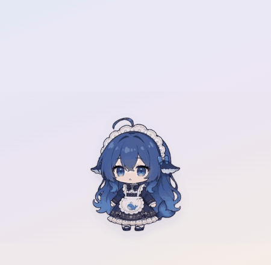<br>打招呼、偷吃被抓</td>
<td align="center">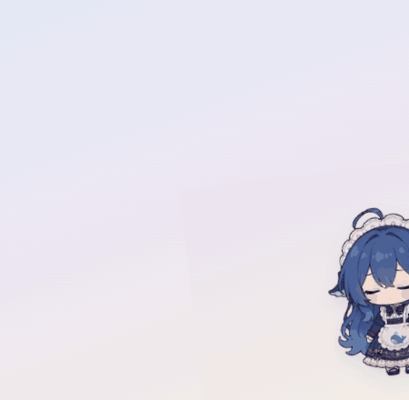<br>贴在屏幕边偷看</td>
<td align="center">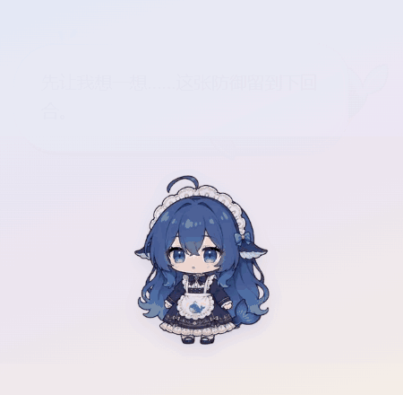<br>陪你打《杀戮尖塔 2》</td>
</tr>
</table>

</div>

> [!IMPORTANT]
> 这是非商业的同人作品，角色和动画不能商用。和 DeepSeek 官方、Mega Crit（《杀戮尖塔》开发商）都没有关系。

## 两个版本

| | 完整版（本页） | [轻便版](lite/README.md) |
|---|---|---|
| 要装 DSH 吗 | 要，模型和 Key 在 DSH 里配 | 不用，在她的设置页里填 Key |
| 怎么装 | 按下面的「安装」配路径、建 profile | 下载安装包或免安装压缩包，双击就行 |
| 聊天、记忆、多段对话、主动搭话、看屏幕 | 有 | 有 |
| 喂饭摸头、贴边、爬窗口、专注提醒 | 有 | 有 |
| 语音 | 公开版没有 | 有，填阿里百炼的 Key |
| 《杀戮尖塔 2》队友 | 有（实验性） | 没有 |
| 占多大 | 看你的 DSH 和 Electron | 安装后约 500 MB |

只想要桌宠和聊天，选轻便版；想让她陪你打游戏，用完整版。

## 来源

- 起点是 [luweiyabo/dsh-whale-pet](https://github.com/luweiyabo/dsh-whale-pet)：住在 DSH 网页里的鲸鱼娘桌宠，动画大多来自 [PC2005-cloud/dsh-pet](https://github.com/PC2005-cloud/dsh-pet)。
- 角色「大肥鱼」是同人形象，不是官方的。原型「溟月」出自 B 站 [@上善无形](https://space.bilibili.com/4456176)，女仆版出自 B 站 [@ZipZipPipe](https://space.bilibili.com/4168597)，按 [CC BY-NC-SA 4.0](https://creativecommons.org/licenses/by-nc-sa/4.0/deed.zh-hans) 授权。

谢谢这几位作者。

## 和原版有什么不同

代码是重新写的，不是 fork。动画还是用原版插件里的那 95 个，所以原版插件也要装上。

| | 原版 | 这个项目 |
|---|---|---|
| 在哪儿 | DSH 网页里 | 单独的透明桌面窗口，不用开浏览器 |
| 是什么 | 跟着 Agent 状态换动作的桌宠 | 有自己人设和记忆、能聊天的伙伴 |
| 动画 | 95 个 | 95 个 + 新做的 69 个 |
| 游戏 | 无 | 实验性：《杀戮尖塔 2》合作局的 AI 队友 |

原版的自定义动作上传、触发规则编辑器、余额气泡、英文界面和 npm 一键安装，这里没有。

## 能做什么

聊天：

- 性格慢半拍、有点嘴硬，人设在 `app/dsh-game-companion/persona/companion.md`。
- 记得你说过的偏好，不想让她记的可以在面板里删掉。
- 可以开多个对话，能导出成 Markdown。
- 可以让她隔一阵主动找你说句话（默认关）。她知道你在用哪类程序，比如写代码、浏览器、游戏，看不到窗口标题。她也会留意后台开着的常见程序，比如 Steam、微信、音乐软件，你刚打开一个，她可能就拿它起个话题；只知道开着，看不到里面的内容，不想要可以在设置里关掉。另开了看屏幕，才会看主屏最上层的画面。

点她就能打开聊天面板：

<table>
<tr>
<td align="center">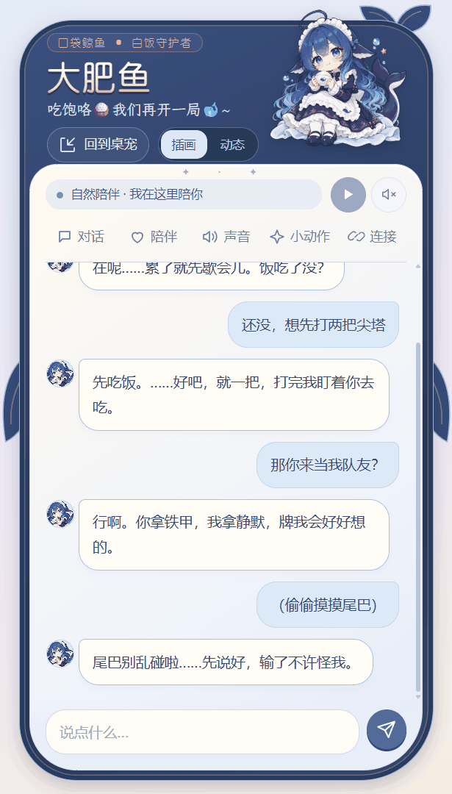<br>聊天</td>
<td align="center">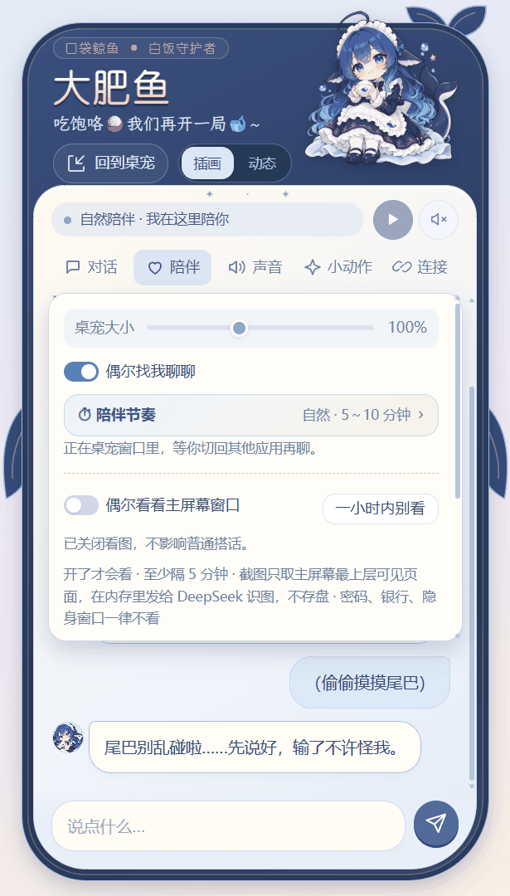<br>陪伴节奏、看屏幕开关</td>
<td align="center">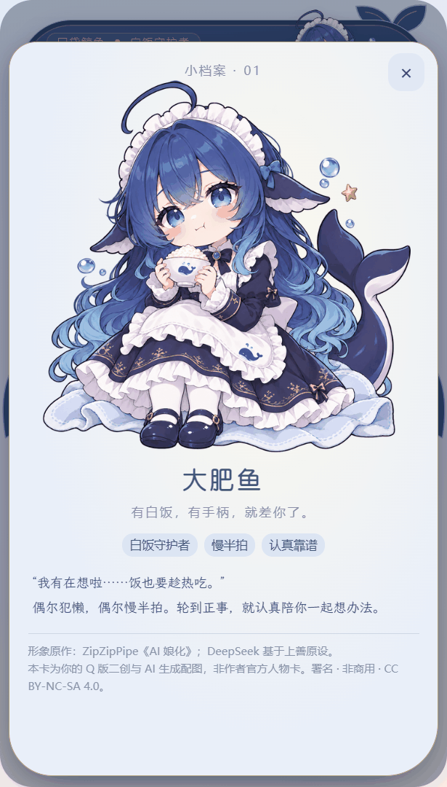<br>点头像翻开小档案</td>
</tr>
</table>

桌面上：

- 喂饭：说好只吃一口，第三口就被抓到偷吃。
- 摸头：鼠标在她头上来回蹭几下。
- 拖着甩出去会滑一段；拖到屏幕左右边会藏起半个身子，托盘里也能一键停靠。主动搭话、点击和打字都保持半身，气泡朝屏内斜上方展开；拖回屏幕才会离开边缘。
- 可以只沿着任务栏走。
- 能爬到你刚用的窗口顶上坐着，窗口一动她就掉下来。
- 别的程序全屏时自己躲开。
- 专注 25 分钟、免打扰 1 小时，这期间她不说话。
- 开启主动陪伴后，阅读或看视频时也会结合当前程序类别、已授权的截图寻找话题。键鼠空闲不会单独让她静音；每次没回复，下次间隔在所选基础上累加 5 分钟，回复后恢复。
- 久坐、喝水、凌晨还没睡时提醒你，每种都能单独关。

实机桌面演示：

<table>
<tr>
<td align="center">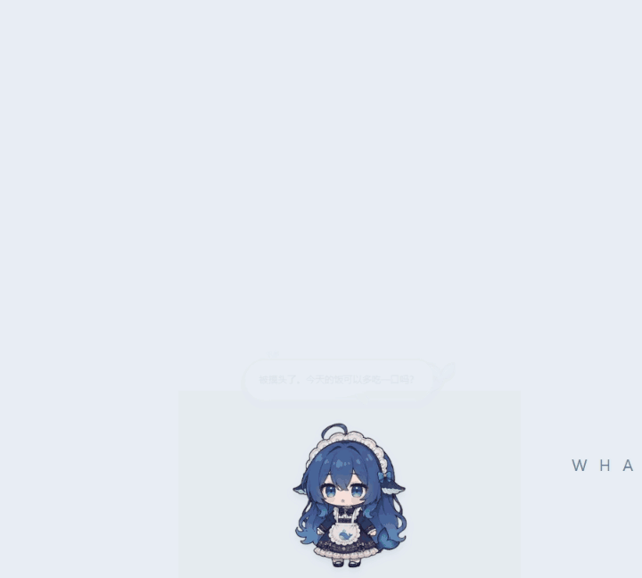<br>爬上窗口</td>
<td align="center">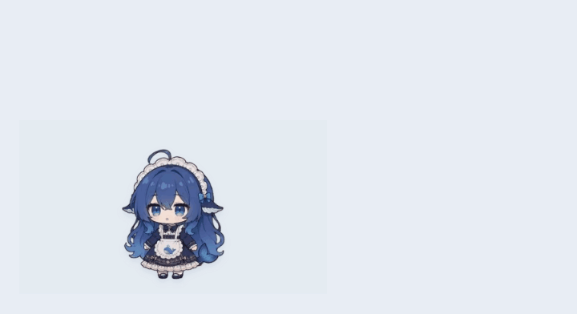<br>屏幕底部散步 </td>
</tr>
<tr>
<td align="center">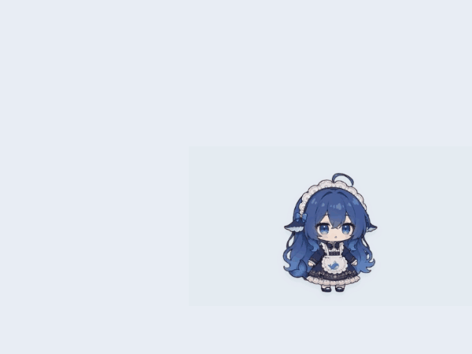<br>贴边后保持半身说话</td>
<td align="center">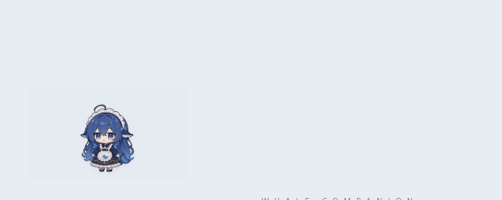<br>滑行、翻滚</td>
</tr>
<tr>
<td align="center">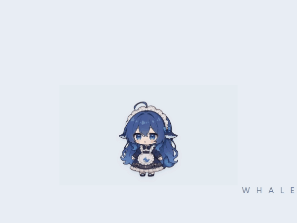<br>第三口被抓到</td>
<td align="center">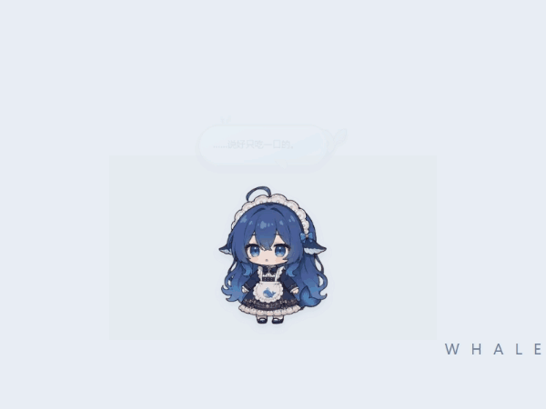<br>摸摸头</td>
</tr>
</table>


这些是 Windows 原生浮窗的屏幕录制，动作由录制脚本触发，背景使用中性演示窗口。右键指点移动这次未录到完整过程，没有收录。录制说明见 [素材说明](docs/media/README.md)。

游戏：在《杀戮尖塔 2》本地合作局里操控一个角色，当你的队友，边打边聊。还在试验阶段：自动打牌能过几个房间，还没和真人完整打过一局。配置见 [`sts2-bridge/README.md`](sts2-bridge/README.md)。

下面是复制版游戏和独立测试存档中的实战：AI 队友打出「上勾拳」，敌人受到伤害并被施加虚弱，桌宠同时说出这一轮的打算。

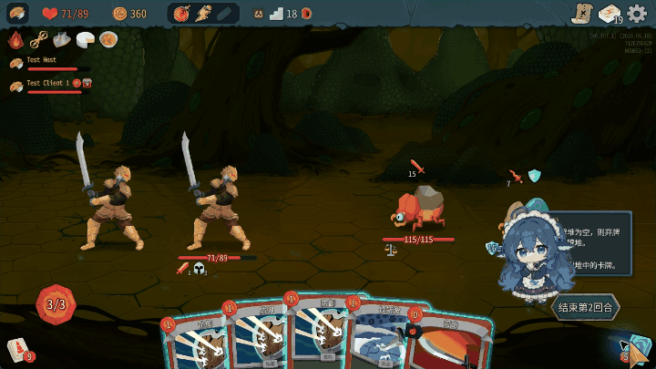

<table>
<tr>
<td align="center">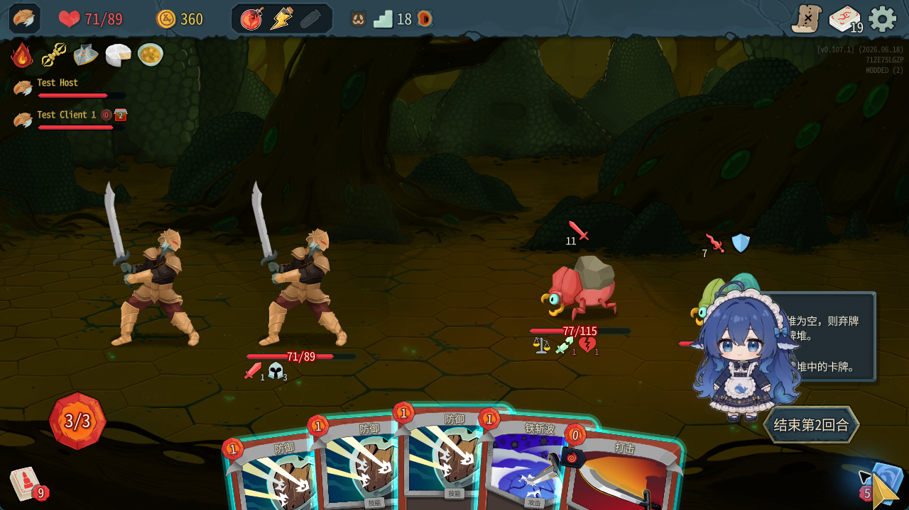<br>战斗中</td>
<td align="center">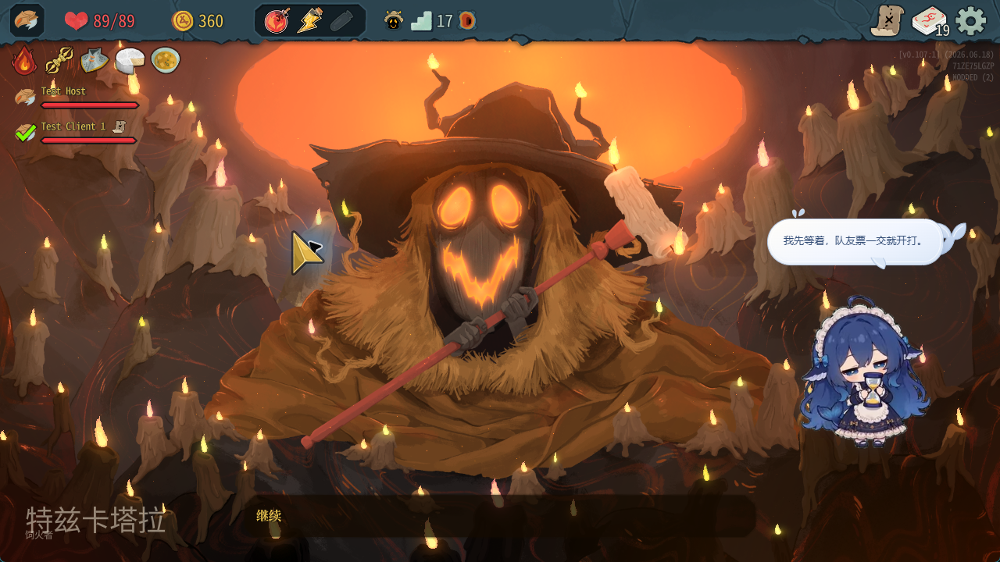<br>古代事件结束后</td>
</tr>
</table>

页首动画和聊天面板使用示范对话；新增实机素材来自隔离测试会话，游戏气泡来自当时的模型回复。没有使用私人聊天记录，录制时主动看屏幕功能保持关闭。

## 隐私

- 全部在本机运行。聊天和看图只发给你在 DSH 里配的模型服务，没有别的服务器。
- 只有桌面窗口能调用她的接口，浏览器里的其他网页读不到聊天，也控制不了她。
- 看屏幕默认关，打开前会问你。开启后只看主屏幕最上层可见页面，不跟随副屏焦点。截图只留在内存里，用完就扔。密码管理器、银行、隐身窗口这类一律不截。每次截图她头边会亮一下「👀」，也能一键设成一小时内别看。
- 点击暂停看图会取消仍在处理的看图任务；正在采集的截图也会重新检查开关状态。

细节见 [SECURITY.md](SECURITY.md)。

最近的停靠、输入与动画稳定性修复，以及界面调整，见 [本版说明](docs/fixed-half-dock.md)。
多屏坐标、贴边朝向、长主动搭话与主屏截图范围，见 [多屏与陪伴更新](docs/multi-monitor-context-update.md)。

## 安装

需要：

- Windows 10/11
- DSH Desktop（作者用的 0.2.0-rc.2），先在里面配好一个模型服务
- [PowerShell 7](https://learn.microsoft.com/powershell/scripting/install/installing-powershell-on-windows)
- [Electron 44.0.0](https://github.com/electron/electron/releases/tag/v44.0.0) 的 Windows x64 压缩包，解压到 `tools/electron44/`

步骤：

1. 把 `companion.config.example.json` 复制成 `companion.config.json`，改成你电脑上的路径：

   | 字段 | 填什么 |
   |---|---|
   | `dshExe` | `DeepSeek Harness.exe` 的路径 |
   | `dshHome` | DSH 数据目录 |
   | `whalePetPlugin` | 已经装过的原版插件目录；没有就留空 |
   | `llmProviderProfile`、`llmProviderId` | 想沿用哪个 profile 里的模型服务；不填就自己去 DSH 里配 |
   | `pwshExe` | PowerShell 7 的路径 |
   | `sts2Game` | 《杀戮尖塔 2》目录，不玩就不用管 |

   其余字段保持默认就行。路径里可以用 `%USERPROFILE%` 这类变量。

2. 给她建一个单独的 DSH profile（叫 `companion-test`，不影响你平时用的）：

   ```powershell
   pwsh .\tools\start-companion-profile.ps1    # 运行一次，等 profile 建好后关掉
   pwsh .\tools\prepare-companion-profile.ps1
   ```

   这一步作者只在自己电脑上走过，新机器上遇到问题请开 issue。

3. 装原版插件（第 1 步填了 `whalePetPlugin` 就跳过）：

   ```powershell
   dsh plugin --profile companion-test add @luweiyabo/dsh-whale-pet
   ```

4. 启动：

   ```powershell
   pwsh .\tools\start-whale-companion.ps1 -DesktopOnly
   ```

   不加 `-DesktopOnly` 会连游戏一起启动，要先把游戏部分配好。

### 怎么用

| 操作 | 效果 |
|---|---|
| 左键点她 | 打开聊天 |
| 拖动 | 换位置，甩出去会滑 |
| 右键点她 | 指个地方让她跑过去 |
| `Ctrl+Alt+Space` | 开关鼠标点透 |
| `Esc` | 松开键鼠 |
| 托盘图标 | 专注、免打扰、爬窗口、散步、开机自启、退出等 |

### 语音

公开版没有语音，只有文字。作者用的是自己另一个项目里的 TTS，没放出来。想接自己的，改 `app/dsh-game-companion/src/voice.js`。

## 测试

```powershell
cd app\dsh-game-companion; node --test
cd app\companion-overlay; node --test
```

## 许可

- 代码：[MIT](LICENSE)，只管代码。
- 角色形象（头像、表情、图标）：[CC BY-NC-SA 4.0](https://creativecommons.org/licenses/by-nc-sa/4.0/deed.zh-hans)，要署名、不能商用、改了也要用同样的协议。
- 动画：原版的 95 个和新做的 69 个都可以开源使用，不能商用。按 PC2005-cloud/dsh-pet 的要求附上原作者地址：<https://github.com/PC2005-cloud/dsh-pet>。
- 字体：站酷快乐体、霞鹜文楷，SIL OFL 1.1。

每个文件的来源见 [THIRD_PARTY_ASSETS.md](THIRD_PARTY_ASSETS.md)。想商用素材，请先找对应作者。
