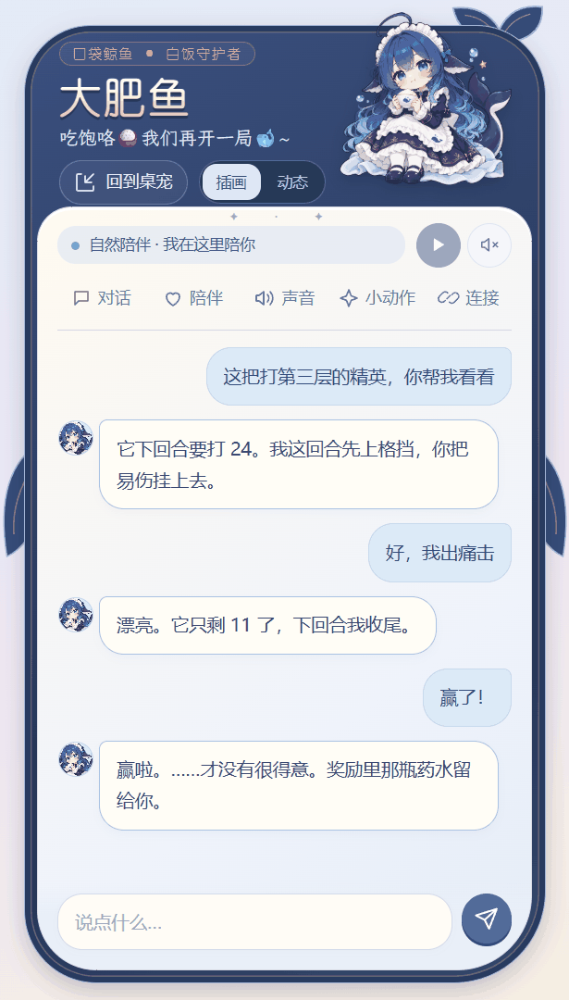
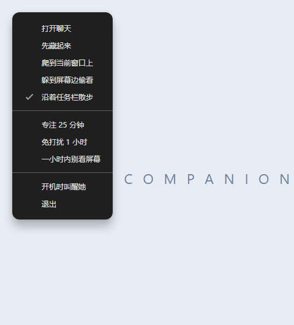

# dsh-whale-companion

A whale-maid who lives on your desktop, chats with you, remembers what you tell her, and can join you in *Slay the Spire 2* co-op. She runs on [DeepSeek Harness](https://github.com/deepseek-ai/deepseek-harness) (DSH). Full docs are in Chinese: [README.md](README.md).

[Download Windows 0.2.0](https://github.com/YufeiXIA/dsh-whale-companion/releases/tag/v0.2.0) · [Mac 0.3.0-macos.1 prerelease](https://github.com/YufeiXIA/dsh-whale-companion/releases/tag/v0.3.0-macos.1) · [Mac installation and permissions](docs/macos-port.md) · [Windows release notes](docs/release-0.2.0.md)

<table>
<tr>
<td align="center"> Greeting, caught snacking</td>
<td align="center"> Peeking from the screen edge</td>
<td align="center"> <i>Slay the Spire 2</i> teammate</td>
</tr>
<tr>
<td align="center"> Chat panel</td>
<td align="center"> Check-in rhythm and screen toggle</td>
<td align="center"> Talking through a fight</td>
</tr>
</table>

The UI is in Chinese. The previews above use sample chats. Actual desktop and game captures are shown below.

> Non-commercial fan work. The character and animations can't be used commercially. Not affiliated with DeepSeek or Mega Crit.

## Two versions

| | Full (this page) | [Lite](lite/README.md) (Chinese docs) |
|---|---|---|
| Needs DSH | Yes; models and keys live in DSH | No; paste a key in her settings page |
| Install | Set paths and a DSH profile (see below) | Installer or portable zip |
| Chat, memory, conversations, check-ins, screen reading | Yes | Yes |
| History retrieval | Relevant excerpts plus search and paginated-read tools | Relevant keyword excerpts; no paginated-read tool |
| Web research | DSH search and page tools | No built-in web research tools |
| Feeding, edge peek, window perching, focus timers | Yes | Yes |
| Voice | Streaming Fish Audio chat; other voices require an external adapter | Alibaba Bailian; see the Lite setup guide |
| Slay the Spire 2 teammate | Yes (experimental) | No |
| Stardew Valley adapter | Experimental integration and mod source; actual farming unverified | No |
| Distribution | Windows source package; bring DSH, Electron and the original animation plugin | Windows x64 installer and portable ZIP; Apple Silicon Mac prerelease DMG / ZIP |

Pick Lite for a desktop pet you can chat with; pick Full if you want her to play games with you.

Windows stable remains 0.2.0. Choose `WhaleCompanion-Lite-0.2.0-Setup.exe` for installation, or `WhaleCompanion-Lite-0.2.0-Portable.zip` to extract and run. `WhaleCompanion-Full-0.2.0-Source.zip` requires the Full setup below. `SHA256SUMS.txt` accompanies these downloads.

Mac Lite 0.3.0-macos.1 is a separate prerelease for **macOS 13+ on Apple Silicon (M-series)**. Intel builds are not provided. Download `WhaleCompanion-Lite-0.3.0-macos.1-macOS-arm64.dmg`, copy **大肥鱼.app** to **Applications**, then open it there. The ZIP contains the same app. This prerelease is ad-hoc signed, without an Apple Developer ID signature or notarization. If Gatekeeper blocks first launch, try opening the app once, then use **System Settings → Privacy & Security → Open Anyway** for that app after checking its source; see [Apple's instructions](https://support.apple.com/102445). The app's menu bar icon opens chat and settings. Basic chat requires neither Screen Recording nor Accessibility: Screen Recording is optional for automatic screen viewing; Accessibility is optional for window perching. Permission changes can require quitting and reopening the app.

Mac data lives in `~/Library/Application Support/大肥鱼/`: `state.json` stores local chats and settings, while `secrets.json` holds keys encrypted through Electron safeStorage and the macOS Keychain. Keychain may prompt again after an ad-hoc signed update; CI does not establish upgrade persistence. See [Mac feature parity and validation status](docs/release-0.3.0-macos.1.md) and [installation details](docs/macos-port.md). Full DSH/game integrations remain Windows-only. The Mac prerelease leaves [Windows 0.2.0 as the latest stable release](https://github.com/YufeiXIA/dsh-whale-companion/releases/latest).

## Credits

Based on [luweiyabo/dsh-whale-pet](https://github.com/luweiyabo/dsh-whale-pet), whose animations mostly come from [PC2005-cloud/dsh-pet](https://github.com/PC2005-cloud/dsh-pet). The character 大肥鱼 is a fan design: the original "Mingyue" is by bilibili [@上善无形](https://space.bilibili.com/4456176), and the maid version is by bilibili [@ZipZipPipe](https://space.bilibili.com/4168597), under CC BY-NC-SA 4.0.

## What's different

The code is new, not a fork. It still uses the original plugin's 95 animations, so you need that plugin too. On top of that:

- She lives in her own transparent desktop window, not the DSH web page.
- Local chat archives and explicit preferences, multiple named conversations, and keyword retrieval across undeleted conversations. Retrieved excerpts carry message, conversation and time references; implicit references may still be missed. Forgetting excludes earlier information from model recall rather than erasing its raw disk record.
- 69 new animations.
- Desktop tricks: feeding, body interactions with local audio responses, head pats, flinging, edge peeking, free roaming, taskbar strolls, focus timers, and stretch, water and bedtime reminders. Window perching follows movement and resizing; the pet drops when the target closes, minimizes, hides or leaves the display completely.
- Optional: she can check in using your app category, a short allow-list of common apps open in the background (Steam, chat, music and so on, category names only, with its own switch), recent conversation and an opt-in glimpse of the visible top window on the primary monitor. A secondary-monitor focus never changes the screenshot target. Proactive messages can use a short paragraph, up to 240 characters.
- Proactive company checks a fixed schedule: five minutes by default, configurable from 1 to 60 minutes. Unanswered messages do not lengthen it. Busy periods, typing, quiet mode, screen lock and sleep defer it, without a burst of missed greetings afterward. Reading or watching without keyboard input does not mute company by itself.
- Attach or paste an image, preview it, then send. Automatic screen viewing is separately opt-in. Higher-resolution automatic captures and richer summaries focus on the main content, with the same primary-monitor boundary.
- Chat replies can select animations by meaning. Actual typing interrupts proactive speech and gives manual conversation priority; focusing the input alone does not hold the listening animation indefinitely.
- Persistent sleep mode loops the closed-eye tail-hug animation with Zzz, pausing roaming, proactive chat, screen viewing and ordinary chat speech. Clicking, typing and dragging do not wake her; use the panel or tray to wake her and restore the previous settings.
- Experimental *Slay the Spire 2* teammate.
- Experimental [*Stardew Valley* adapter and mod source](app/dsh-game-companion/STARDEW.md). Actual farming, in-game bubbles and voice have not been validated; separate setup and testing are still needed.

When docked, she stays half-hidden during greetings, replies, clicks and typing. Speech bubbles open diagonally toward the inside of the screen, with the input bar beside the edge. Drag her out to undock. This update also keeps the previous animation visible until its replacement starts, cancels pending screen glances when paused, and refines the title font and header position. See [release notes (Chinese)](docs/fixed-half-dock.md).

Clicking the body triggers a body interaction. Hover nearby for quick chat, then use the whale button or the tray's Open chat command for the panel. Earlier demo captures below illustrate individual actions; the [0.2.0 notes](docs/release-0.2.0.md) describe current behavior.

## Live captures

These are screen recordings of native Windows overlay windows. A capture script triggers the actions over a neutral demo background.

<table>
<tr>
<td align="center"> Climbing onto a window</td>
<td align="center"> Bottom-edge stroll (taskbar itself not shown)</td>
</tr>
<tr>
<td align="center"> Talking while docked</td>
<td align="center"> Sliding and tumbling</td>
</tr>
<tr>
<td align="center"> Caught on the third serving</td>
<td align="center"> Head pats</td>
</tr>
</table>

The right-click point-and-run capture did not produce a complete sequence, so it is omitted. See [capture notes](docs/media/README.md).

The following clip is an actual co-op battle in a copied test installation of *Slay the Spire 2*. The AI teammate plays Uppercut, dealing damage and applying Weak while the pet explains the plan. This remains experimental: it can clear several rooms, but has not completed a full run with a human.

<table><tr>
<td align="center"> In battle</td>
<td align="center"> After an Ancient event</td>
</tr></table>

All new captures use an isolated test conversation; game bubbles are model replies from that session. No private chat history is included, and proactive screen viewing stayed off. Game setup: [sts2-bridge/README.md](sts2-bridge/README.md) (Chinese).

## Setup

You need Windows 10/11, DSH Desktop 0.2.0-rc.2 (the current validation target), PowerShell 7, and Electron 44.0.0 unpacked into `tools/electron44/`. The DSH installation must include `@deepseek-ai/dsh-web`, `@deepseek-ai/dsh-web-search-deepseek`, `@deepseek-ai/dsh-web-fetch-http` and `@deepseek-ai/dsh-tool-web`. Other DSH versions have not been validated.

1. Copy `companion.config.example.json` to `companion.config.json` and fill in your paths.
2. Run `pwsh tools/prepare-companion-profile.ps1` first. It prepares the separate `companion-test` profile, creating its base/web configuration when absent and linking the companion plugin. Configure a model provider for that profile, or set `llmProviderProfile` and `llmProviderId` in step 1 to copy an existing provider configuration.
3. Install the original plugin unless you already linked it through `whalePetPlugin`: `dsh plugin --profile companion-test add @luweiyabo/dsh-whale-pet`.
4. Start her: `pwsh tools/start-whale-companion.ps1 -DesktopOnly`.

For voice, use the public Fish Audio voice 「蓝色大肥鱼」 (made by Fish Audio user 大大大肥鱼): save your Fish Audio API key as `fish-audio-key.txt` in the data folder (default `~/.dsh/game-companion/`), restart DSH, then pick it under Sound in the panel. Your account needs available quota for the model. Fish chat audio streams as PCM while it is generated; latency depends on the network and service. Local body responses and installed preview clips play without a synthesis request. Longhua and Momo chat synthesis require a separately installed adapter and credentials, which are not bundled.

Full chat uses the model configured in DSH. Its current image analysis calls the official DeepSeek API separately and needs `DEEPSEEK_API_KEY` in the host environment. Raw images remain in memory; observation text can enter chat history. Optional web research uses public search and page tools. See [privacy and security](SECURITY.md) for data destinations and limits of sensitive-window filtering.

## License

Code is [MIT](LICENSE). The character art is CC BY-NC-SA 4.0. The animations are fine for open-source use but not for commercial use, and derivatives must link <https://github.com/PC2005-cloud/dsh-pet>. Fonts are OFL 1.1. Details: [THIRD_PARTY_ASSETS.md](THIRD_PARTY_ASSETS.md).
